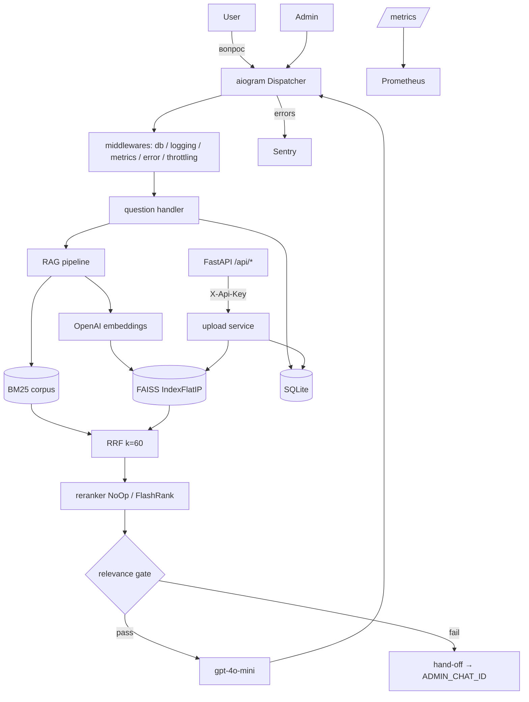

# Telegram Bot AI Assistant

> Production-ready Telegram-бот техподдержки на базе RAG (Retrieval-Augmented Generation). Отвечает на вопросы пользователей по вашей базе знаний с цитированием источников и эскалацией к оператору, если ответа в KB нет.


## Зачем

Команды техподдержки тратят до 70% времени на типовые вопросы, ответы на которые уже есть в FAQ и документации. Этот бот закрывает их автоматически, оставляя людям только нестандартные кейсы. Развёртывание — `docker compose up -d`, время до первого ответа — меньше 5 минут после получения ключей.

## Возможности

- Гибридный поиск: BM25 (rank_bm25) + dense (FAISS cosine) + Reciprocal Rank Fusion. На 20–40% точнее голого top-k dense.
- Re-ranking через FlashRank cross-encoder (опционально, ENV-флаг).
- Цитирование источников: каждый ответ содержит `[^N]` маркеры и список исходных файлов.
- "Честное не знаю": если top-1 cosine ниже порога — бот не галлюцинирует, а передаёт оператору.
- Hand-off оператору: вопрос с контекстом пересылается в `ADMIN_CHAT_ID` с inline-кнопкой "Взять в работу".
- Feedback loop: 👍/👎 после каждого ответа, для негативных — опциональный комментарий.
- Админ-панель в TG: загрузка `.md`/`.txt`, статистика, список и удаление документов с reindex.
- REST API: тот же upload через `POST /api/docs` с `X-Api-Key`, rate-limited через slowapi.
- Наблюдаемость: structlog JSON-логи с redaction секретов, Prometheus `/metrics`, опциональная интеграция с Sentry.
- Production safety: atomic FAISS persistence (tmp + rename + fsync), tenacity retry на OpenAI, graceful shutdown ≤ 10 секунд.
- Docker-only deploy: multi-stage образ, non-root user, healthcheck.
- Apache 2.0 license: patent grant защищает в B2B-сценариях.

## Быстрый старт

```bash
git clone https://github.com/FilatovArtem/telegram-bot-ai-assistant.git
cd telegram-bot-ai-assistant
cp .env.example .env
# Заполните BOT_TOKEN, OPENAI_API_KEY, ADMIN_IDS, API_ADMIN_TOKEN
docker compose up -d --build
curl http://localhost:8000/health
# {"status":"ok"}
```

Подробные инструкции по получению ключей — [`docs/setup/01-tokens-and-keys.md`](docs/setup/01-tokens-and-keys.md).

## Пример диалога

```
User: Какие курсы у вас есть?
Bot: Мы предлагаем три курса: Python для начинающих (12 недель, 25 000 руб),
     Веб-разработка с React (16 недель, 35 000 руб) и Data Science с нуля
     (20 недель, 45 000 руб). [^1]

     Sources:
     [^1] sample_faq.md

     [👍 Помог] [👎 Не помог] [👤 Оператор]

User: Какой курс по Rust?
Bot: Я не нашёл точного ответа в базе знаний. Передаю ваш вопрос оператору.

     [👤 Связаться с оператором]
```

## Архитектура



Бот и FastAPI работают в одном asyncio-процессе. Vector store, retriever, OpenAI client живут в памяти и инжектятся в handlers через `dp[...]`, а в FastAPI — через `app.state.deps`.

## Конфигурация

Полный список ENV — в [`.env.example`](.env.example).

| Переменная | Описание | Default |
|---|---|---|
| `BOT_TOKEN` | Токен от @BotFather | — (required) |
| `ADMIN_IDS` | CSV Telegram user ID админов | — (required) |
| `ADMIN_CHAT_ID` | Chat ID для hand-off (0 = выключено) | `0` |
| `OPENAI_API_KEY` | Секретный ключ OpenAI | — (required) |
| `OPENAI_MODEL` | Модель для генерации | `gpt-4o-mini` |
| `EMBEDDING_MODEL` | Модель эмбеддингов | `text-embedding-3-small` |
| `API_ADMIN_TOKEN` | Secret для `X-Api-Key` | — (required) |
| `API_PORT` | Порт FastAPI | `8000` |
| `DATABASE_URL` | Async SQLAlchemy URL | `sqlite+aiosqlite:///data/bot.db` |
| `RELEVANCE_THRESHOLD` | Минимум cosine top-1 для ответа | `0.75` |
| `RELEVANCE_MIN_GAP` | Минимум зазор top-1 vs avg(2..5) | `0.05` |
| `BM25_ENABLED` | Гибридный поиск с BM25 | `true` |
| `RERANK_ENABLED` | Cross-encoder reranking (FlashRank) | `false` |
| `TOP_K_DENSE` / `TOP_K_BM25` / `TOP_K_FINAL` | Размеры кандидатов | `50` / `50` / `10` |
| `MAX_CHUNK_TOKENS` / `CHUNK_OVERLAP` | Параметры чанкования | `500` / `100` |
| `MAX_UPLOAD_BYTES` | Лимит размера документа | `10485760` |
| `THROTTLE_PER_USER_PER_SEC` | Rate-limit per user | `1.0` |
| `LOG_LEVEL` / `LOG_JSON` | Логи | `INFO` / `true` |
| `SENTRY_DSN` | Опциональная отправка ошибок в Sentry | — |
| `METRICS_INTERNAL_ONLY` | Защитить `/metrics` | `false` |
| `SEED_SAMPLE_ON_FIRST_RUN` | Загрузить `sample_faq.md` если индекс пуст | `true` |

## REST API

Все `/api/*` требуют заголовок `X-Api-Key: $API_ADMIN_TOKEN`.

| Method | Path | Auth | Rate limit | Назначение |
|---|---|---|---|---|
| GET | `/health` | — | — | Liveness |
| GET | `/ready` | — | — | DB ping + размер индекса |
| GET | `/metrics` | `METRICS_INTERNAL_ONLY` | — | Prometheus |
| GET | `/api/stats` | X-Api-Key | 30/min | Агрегированная статистика |
| GET | `/api/docs` | X-Api-Key | 30/min | Список документов |
| POST | `/api/docs` | X-Api-Key | 10/min | Загрузка `.md`/`.txt` |
| DELETE | `/api/docs/{id}` | X-Api-Key | 10/min | Soft-delete документа |

Подробнее — [`docs/setup/03-admin-guide.md`](docs/setup/03-admin-guide.md).

## Стоимость OpenAI

При типовом запросе (~600 input + ~150 output токенов LLM + 100 токенов embedding) — ориентир $0.00018 за вопрос на `gpt-4o-mini` + `text-embedding-3-small`.

| Вопросов в день | За месяц | $/мес | $/год |
|---|---:|---:|---:|
| 100 | 3 000 | 0.55 | 6.50 |
| 1 000 | 30 000 | 5.50 | 66 |
| 10 000 | 300 000 | 55 | 660 |
| 100 000 | 3 000 000 | 550 | 6 600 |

Индексирование KB ~1M токенов — единоразово $0.02. Цифры — рекомендации, реальная стоимость зависит от длины контекста и ответа (`max_tokens=500`).

## Roadmap

- v1.1: PDF/DOCX (`pymupdf4llm`, `python-docx`), переход на Qdrant/pgvector через интерфейс `VectorStore`, контекстуальный retrieval (Anthropic-style) с prompt caching, eval pipeline через RAGAS в CI.
- v1.2: webhook mode для production, multi-tenancy через `tenant_id` в БД, web admin UI, RBAC для админов.
- v2.0: голос (Whisper STT + TTS), картинки (vision-модели), интеграции с Zendesk / Intercom.

## Contributing

См. [`CONTRIBUTING.md`](CONTRIBUTING.md) — dev setup через `uv`, commit convention (Conventional Commits), quality gates (ruff + mypy + pytest).

## License

[Apache License 2.0](LICENSE) — patent grant + trademark clause + change documentation. `SPDX-License-Identifier: Apache-2.0`.

## Author

Артём Филатов — [@Siki_sing](https://t.me/Siki_sing)
